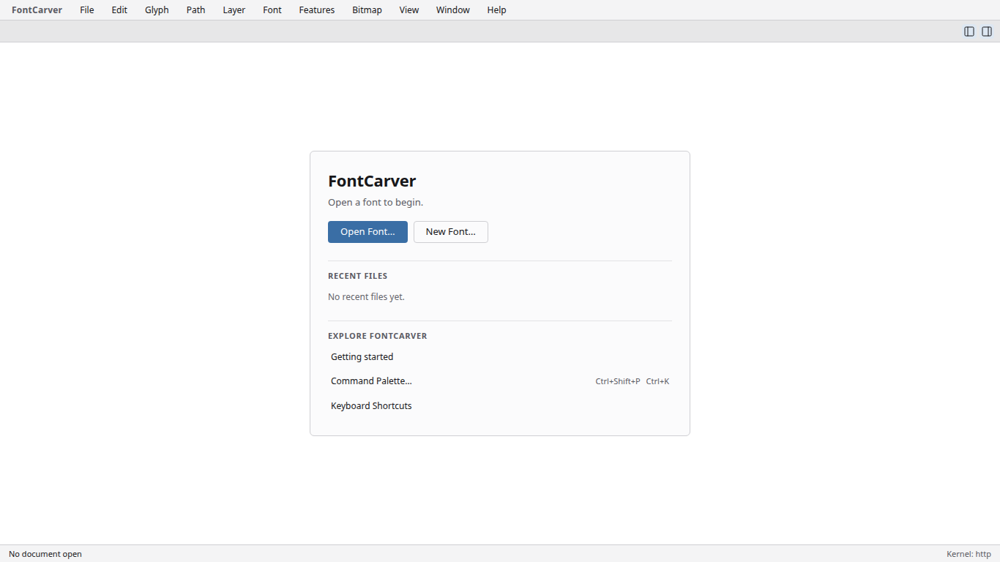
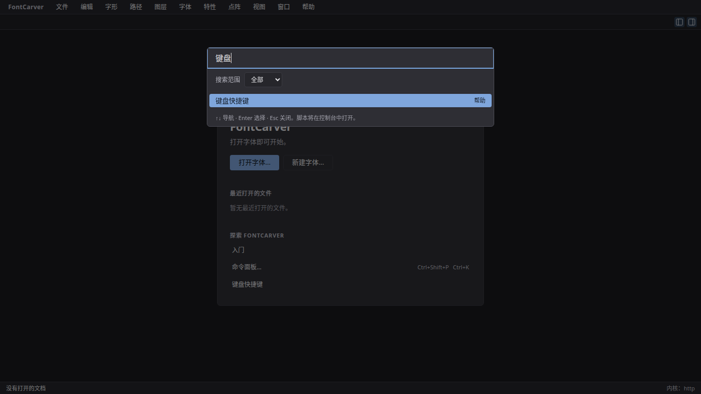

# Context help

FontCarver's help lives inside the application and works without a network
connection. It has two layers: a **quick help** bubble that appears where you are
working, and a **help article** that explains the surrounding workflow.

## Start from the welcome screen

With no font open, look below **Recent Files** for **Explore FontCarver**.
The three entries are available before you open or create a font.

Choose an entry according to what you need:

| Position | English label      | Chinese label | What it opens                                           |
| -------- | ------------------ | ------------- | ------------------------------------------------------- |
| Top      | Getting started    | 入门          | The help article explaining the basic editing workflow. |
| Middle   | Command Palette…   | 命令面板…     | Search for an action by name.                           |
| Bottom   | Keyboard Shortcuts | 键盘快捷键    | The current bindings and their editing controls.        |

The entries keep the same order in the
[Chinese interface with dark appearance](../acceptance/p5ux/start-discovery/welcome-dark-zh-1366.png).
Use **Tab** and **Shift+Tab** to move between buttons, then **Enter** to open
the focused entry. **Open Font…**, **New Font…** and recent files remain above
these help options.

To find shortcut settings through search:

1. Choose **Command Palette…**. The search field receives focus immediately.
2. Type `keyboard` in the English interface, or `键盘` in Chinese.
3. Select **Keyboard Shortcuts** with the arrow keys if needed, then press
   **Enter** to open its settings. Press **Escape** to close settings and return
   to the welcome-screen button.

The screenshot shows the Chinese search example. You can also open the same
settings directly from the bottom welcome entry. See the
[shortcut guide](../keyboard-shortcuts.md) for binding and customization details.

Shortcut hints beside **Command Palette…** follow your current keymap,
including custom bindings and keys you have removed. The screenshots show Linux
bindings; use the hints displayed on your platform. Nothing opens until you
choose an entry.

## Quick help

Rest the pointer on a control for about half a second, or move keyboard focus to
it, and a small bubble appears beside it with

- the control's name,
- one line saying what it does,
- its current keyboard shortcut, when it has one,
- why it cannot be used right now, when it cannot,
- and **Open help article**, which opens the full article for that part of the
  interface.

The bubble never takes focus, so it cannot interrupt what you were doing. It
disappears when you move away, press a key, click, or press Escape. It does not
appear for a control that an open dialog has covered, and it steps aside while
the help article itself is open.

Every command in the application — everything in the menus and the command
palette — has its own one-line description, so the bubble describes the exact
action rather than the menu it sits in. A test keeps that complete: a command
without a help entry fails the build.

## The help article

Press **F1**, choose **Help → Context Help**, or find **Context Help** in the
command palette. The shortcut editor can change the default F1 binding; help
stays reachable from the Help menu even if its key is unbound.

The article opens on the topic for what you are doing:

- the active tab's workflow — font overview, outline and text editing, bitmap
  editing, Font Info, OpenType features;
- the open dialog's own topic, named, when a dialog has the screen: export,
  preferences, shortcuts, new font, adding glyphs, finding problems, recovery,
  outline operations, renaming many glyphs, working across documents, workspaces,
  scripts and plugins;
- the topic of the control you hovered or focused, when it declares one.

Above the article, help repeats what it captured, so you can see why you are
reading this page:

- the **command** the control runs, with its description, its live binding, and
  the reason it is unavailable if it is;
- the **active tool** of the Edit tab and its gesture hint;
- the **focused control** and its own description;
- the **current dialog**'s name.

Use **Help topic** to read another article. Choosing a topic leaves your document,
your selection and the settings of any open dialog exactly as they were. Help
reads labels and descriptions only; it never copies the contents of a field into
the article.

Tab and Shift+Tab move between the topic selector and **Close Help**. Escape or
**Close Help** returns focus to the control you were using, and a dialog you
opened help from stays open with its settings intact.

Help articles are also the right place to look for a workflow you have not used
before: each one gives a summary and three steps, in the order the workflow
actually runs.

## Adding contextual help to a control

UI contributors have three markers.

- `helpHint('features')` (or another `HelpTopic`) supplies the translated topic
  summary as an `aria-description` and marks the control with `data-help-topic`,
  which both F1 and quick help read. Give the control its own accessible label as
  usual. An explicit topic takes priority over the dialog's or the tab's.
- `helpCommand('path.removeOverlap')` marks a control as running one command.
  Help then reads that command's entry in `shell/commandHelp.ts`: its article, its
  one-line description, its live binding and its disabled reason. The menu rows
  and the command palette set this marker themselves, so a command gets its help
  everywhere it appears without any per-surface work.
- An existing `aria-describedby` or `aria-description` is shown as the focused
  control's own description when there is no command entry to prefer. A bare
  `title` is read too, but it is a last resort: it is invisible to keyboard and
  touch users, and `helpHint` therefore no longer sets one.

A new command must be given an entry in `shell/commandHelp.ts` with its topic and
a `quickHelp.*` key; `shell/commandHelp.test.ts` fails otherwise, and also fails
on an entry for a command that no longer exists, on a topic that is not shipped,
and on a summary key that is missing from the English catalogue.

The shell mounts `ContextHelpDialog` once, which owns both the quick-help bubble
and the article, and calls `registerHelpCommands` with the other built-in command
registrations. The shortcut dispatcher honours the command's `allowInModal` and
`allowInInput` flags, so the active user binding also works inside dialogs and
text fields. Ordinary editing commands remain subject to the modal guards.
